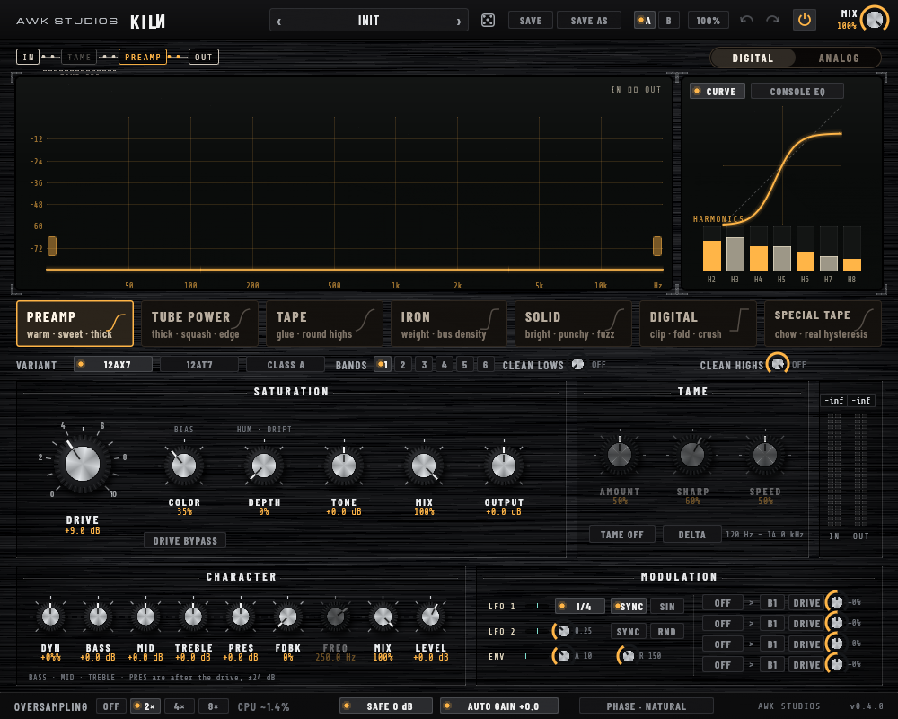
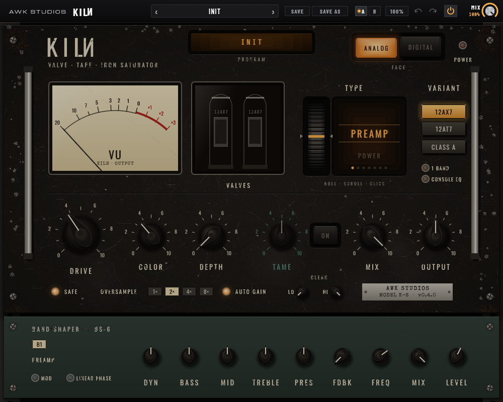

# KILN

**Saturator with a de-resonance layer (TAME) that runs first.**





KILN has six saturation types with three variants each. TAME runs before the drive and takes the harsh resonances out, so you can push hard without fizz. It has two faces over the same controls: DIGITAL (spectrum, curve and harmonics) and ANALOG (a worn rack unit).

## Features

- **Types:** PREAMP, TUBE POWER, TAPE, IRON, SOLID, DIGITAL, three variants each.
- **TAME:** a de-resonator in front of the drive, with a draggable range. TAME DELTA plays only what it removes.
- **Up to 3 bands**, each with its own type and drive, plus solo and bypass per band.
- **CONSOLE EQ:** a classic British preamp EQ, before or after the drive.
- **AUTO GAIN**, MIX, OUTPUT, oversampling (OFF to 8x) and SAFE.
- 34 factory presets.

## Install

Windows 64-bit, VST3. Built and tested in FL Studio.

1. Download `Kiln-v0.2.2-win64.zip` from [Releases](../../releases/latest).
2. Copy `Kiln.vst3` into `C:\Program Files\Common Files\VST3\`.
3. Copy the files in `presets` into `Documents\Awknode\Presets\Kiln\` (create the folder if it doesn't exist).
4. Rescan plugins in your DAW.

## Using it

Every awk studios plugin has the same top strip: preset browser, A/B, undo/redo, power (bypass) and a global MIX. Knobs drag up and down (hold Ctrl or Shift for fine control), scroll to nudge, and double-click to reset. **SAFE** in the footer is an output limiter that keeps the plugin from going over 0 dBFS; it's on by default.

The full control reference is in the **[manual](docs/MANUAL.md)**.

## Build from source

You'll need Docker. Clone this repo next to the [nice-plug-awk](https://github.com/awknode/nice-plug-awk) framework fork, then run the build script:

```sh
git clone https://github.com/awknode/kiln
git clone -b awk-studios https://github.com/awknode/nice-plug-awk
cd kiln && ./build.sh
```

The plugin lands in `target/bundled/Kiln.vst3`.

## License

GPL-3.0. See [LICENSE](LICENSE). Built with [nice-plug](https://codeberg.org/RustAudio/nice-plug).

---

More awk studios plugins: [VISE](https://github.com/awknode/vise) · [SALVE](https://github.com/awknode/salve) · [HOIST](https://github.com/awknode/hoist) · [PATINA](https://github.com/awknode/patina) · [CHOPSHOP](https://github.com/awknode/chopshop) · [THROWBACK](https://github.com/awknode/throwback) · [THROW FX](https://github.com/awknode/throw-fx) · [KICKNULL](https://github.com/awknode/kicknull) · [ALLEYVERB](https://github.com/awknode/alleyverb) · [WAVETAG](https://github.com/awknode/wavetag) · [dBCOMP](https://github.com/awknode/dbcomp) · [dBVOX](https://github.com/awknode/dbvox)

### Dice (random patch)
The dice button next to the preset box rolls a random patch. **Shift+click** nudges every control a little instead. **Undo** takes either back. Levels, mix, oversampling, the safety limiter and bypass are never touched, so a roll can't blast you or go silent.
